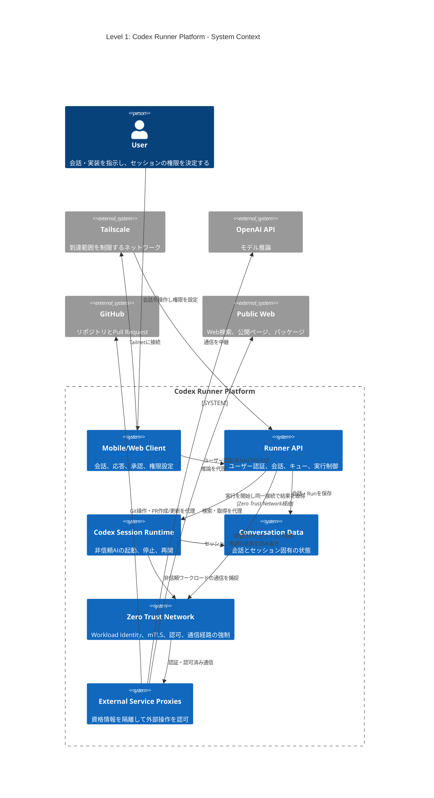
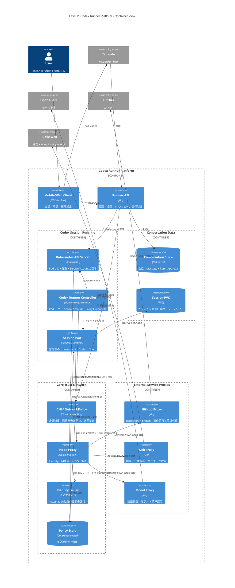
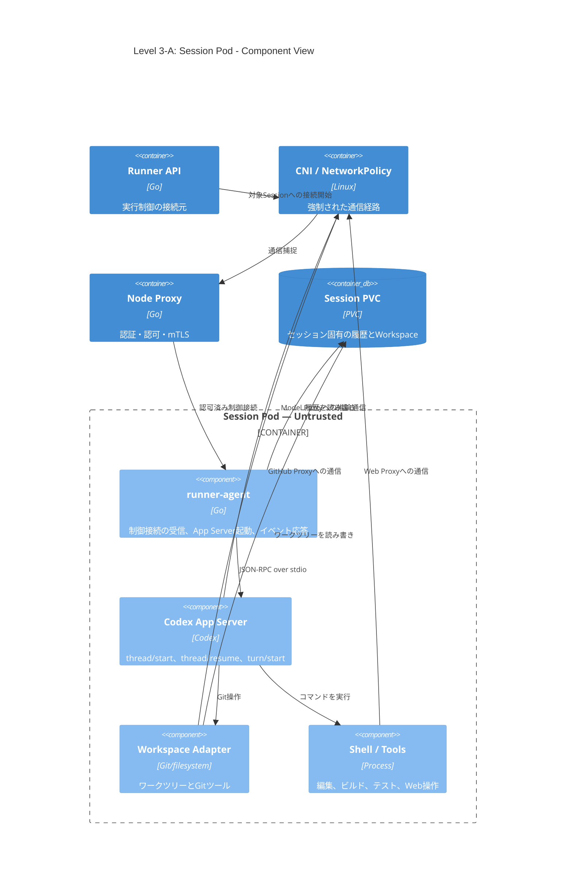
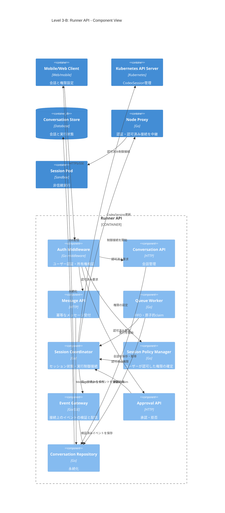
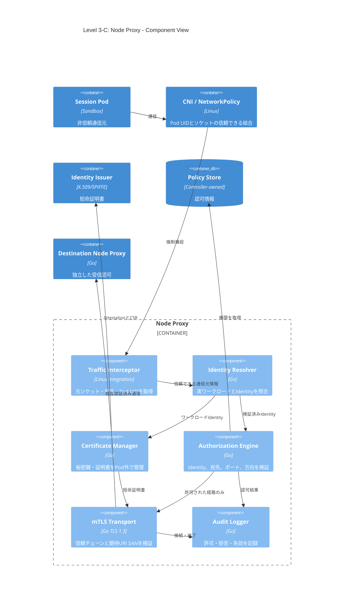
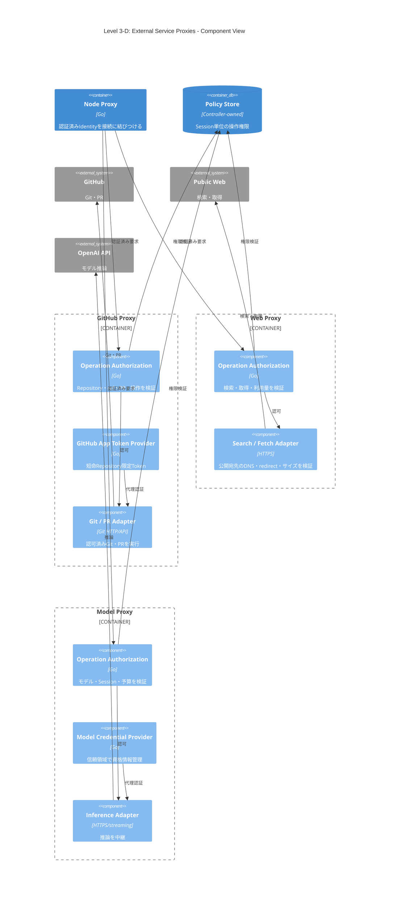
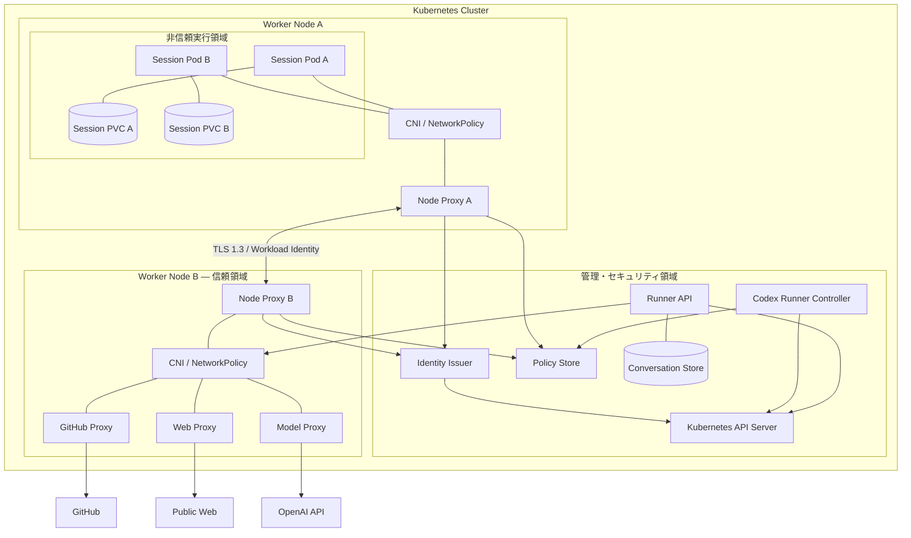
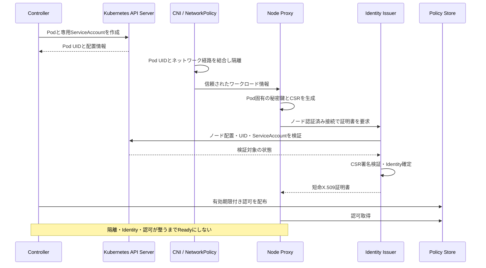
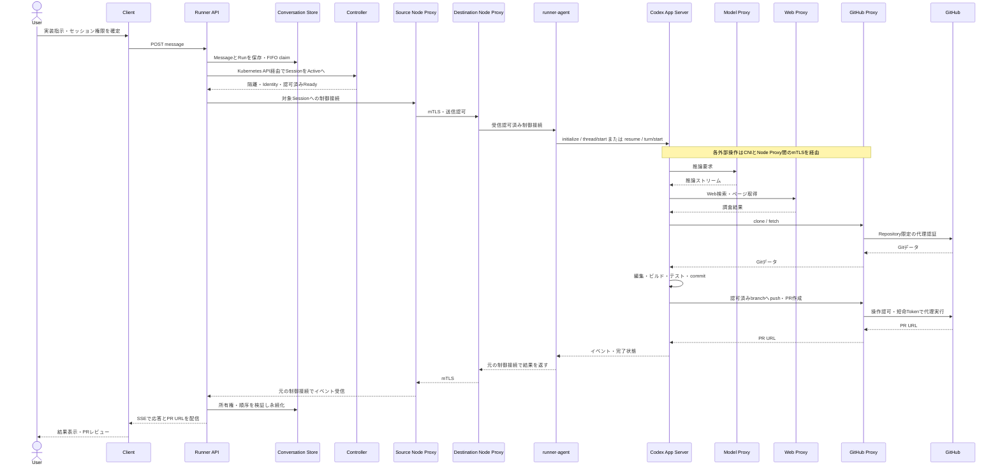
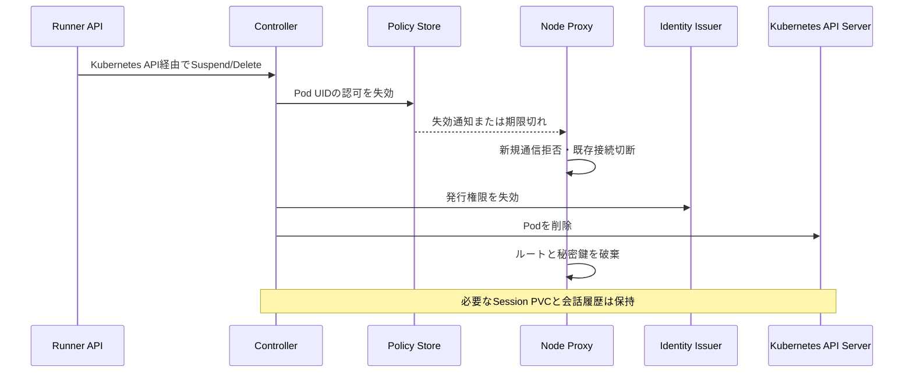

# Codex Runner Controller アーキテクチャ図

本書は [design.md](design.md) の目標アーキテクチャをC4 Level 1〜3、Deployment View、主要シーケンスで表現する。実装履歴は扱わない。各Levelで境界・名称・責務を維持する。通信の矢印は新規接続を開始する側から描き、同一接続の応答は省略する。mTLSはNode Proxy間で終端し、ローカル区間はCNIによって隔離する。

## C4 Level 1: System Context

## C4 Level 2: Container View

Zero Trust Networkは全ワークロードの通信に適用される分散基盤であり、単一の中継サーバーではない。論理的な接続先を示す関係はすべて強制された経路を通る。Kubernetes API等の基盤通信は独立した認証とRBACで保護する。

## C4 Level 3-A: Session Pod Component View

Session Pod内には管理用資格情報を置かない。runner-agentも非信頼とする。Runner APIが開始した接続に対してイベント、結果、承認要求を返す。

## C4 Level 3-B: Runner API Component View

## C4 Level 3-C: Node Proxy Component View

## C4 Level 3-D: External Service Proxies

各Proxyは独立した信頼境界で、認証済みの呼び出し元を用いて操作単位の認可を行う。以下の共通コンポーネントは各Proxy内で実行する。資格情報をAIへ返さない。

## Deployment View: Node Proxyと隔離境界

Session Pod AとBは同一Nodeでも通信不可。Node Proxyの証明書と秘密鍵は非信頼領域の外に置く。管理コンポーネントの配置は例示であり、全対象ノードにNode Proxyを配置する。Runner APIからSession Podへの接続は送信側・受信側Node Proxyを経由する。

## シーケンス: Workload Identityの発行

## シーケンス: メッセージ受付から自律実行・PR作成まで

## シーケンス: 権限失効と停止

## 図の整合性

- Level 1の境界はLevel 2で維持し、Level 3では対象Containerの内部を分解する。
- Node Proxyと外部サービスProxyの責務を混同しない。
- Session PodからRunner API、Conversation Store、Kubernetes API、他Session、外部ネットワークへの直接接続は許可しない。
- Session PVCへのアクセスは対象Sessionのみに限定する。
- mTLS・Identity・認可・NetworkPolicy・Sandboxは独立した防御層とする。
- C4図の表示はMermaidの対応状況に依存する。[Mermaid C4 diagrams](https://mermaid.js.org/syntax/c4.html)
