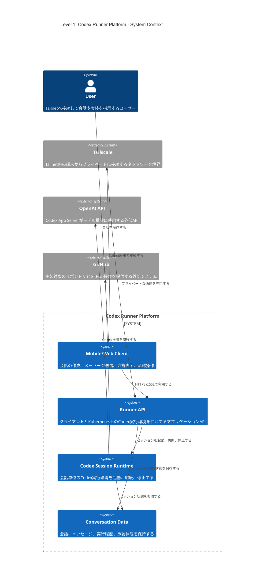
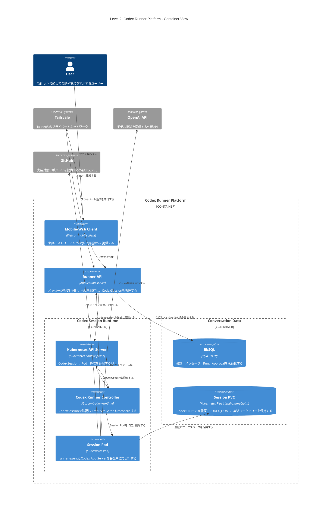
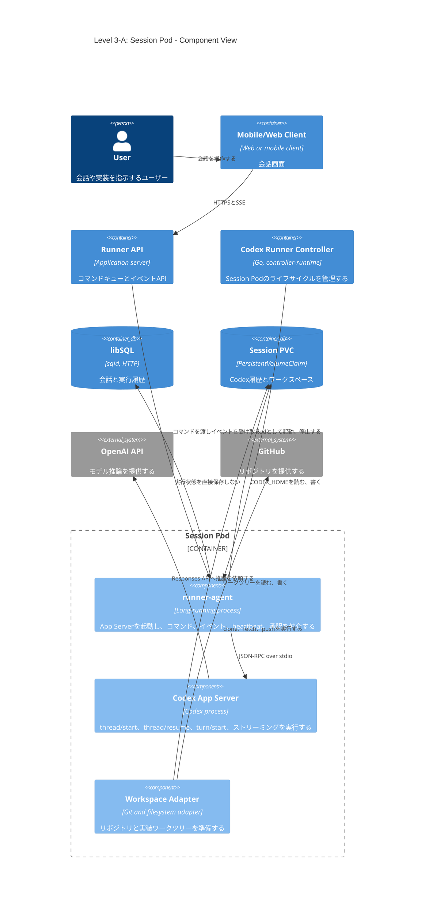
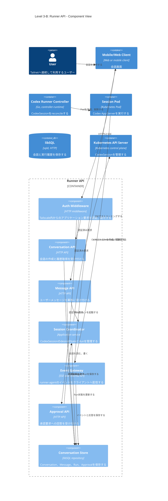
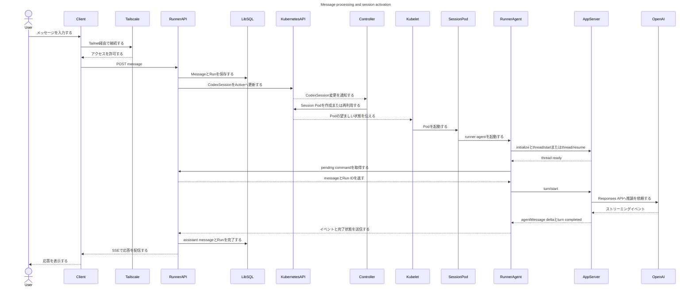

# Codex Runner Controller アーキテクチャ図
この文書は、C4モデルのLevel 1からLevel 3、および主要なメッセージ処理フローを示す。
## 図の読み方
抽象度が変わっても、次の要素は同じ名前と責務で引き継ぐ。
- Mobile/Web Client
- Runner API
- Codex Session Runtime
- Conversation Data
- Session Pod
- Codex Runner Controller
- Codex App Server
- libSQL
- Session PVC
Level 1では大きな境界だけを示す。Level 2ではその境界の内部にKubernetesのコンテナとデータストアを追加する。Level 3では、Session PodとRunner APIをそれぞれComponentへ分解する。親境界は消さず、分解対象の内部に子要素を追加する。
MermaidのC4記法は現在もexperimental扱いであり、表示環境によって対応状況が異なる可能性がある。[Mermaid C4 diagrams](https://mermaid.js.org/syntax/c4.html)
## C4 Level 1: System Context
Level 1では、ユーザー、クライアント、Runner API、セッション実行環境、会話データという製品上の大きな境界を固定する。

## C4 Level 2: Container
Level 2では、Level 1の4つの主要な枠を維持し、その内部をKubernetesの実行単位へ分解する。
- Codex Session Runtime
  - Kubernetes API Server
  - Codex Runner Controller
  - Session Pod
- Conversation Data
  - libSQL
  - Session PVC

## C4 Level 3-A: Session Pod Component View
Level 3-Aは、Level 2のSession Podという枠を維持し、その内部をComponentへ分解する。
- Session Pod
  - runner-agent
  - Codex App Server
  - Workspace Adapter
runner-agentとCodex App Serverは初期設計では同じコンテナ内のプロセスである。Workspace Adapterは、Git操作とワークスペース準備を担当する論理Componentとして表現する。

## C4 Level 3-B: Runner API Component View
Level 3-Bは、Level 2のRunner APIという枠を維持し、その内部をComponentへ分解する。Session Podは外部のコンテキストとして残す。
- Runner API
  - Auth Middleware
  - Conversation API
  - Message API
  - Session Coordinator
  - Event Gateway
  - Approval API
  - Conversation Store

## シーケンス図: メッセージ受付からCodex応答まで
このフローでは、Session Podが存在しない場合はControllerが作成し、存在する場合は再利用する。App Serverのthread/startとthread/resumeは、runner-agentが保存済みの状態を見て選択する。

## 対応関係のルール
- Level 1の枠はLevel 2でも残す。
- Level 2で追加するKubernetesリソースは、Level 1のCodex Session Runtimeの内部に置く。
- Level 2で追加する永続化リソースは、Level 1のConversation Dataの内部に置く。
- Level 3では、分解対象の枠を残したままComponentを追加する。
- Session PodとRunner APIは責務が異なるため、Level 3を2枚に分ける。
- 名前を変更して別の要素に見せない。責務を変更する場合は設計変更として記録する。
- MermaidのC4図でレイアウトが崩れる場合も、要素を削除せず、境界の宣言順と関係の向きを調整する。

