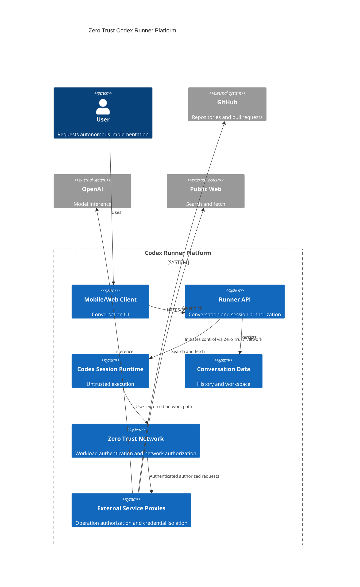
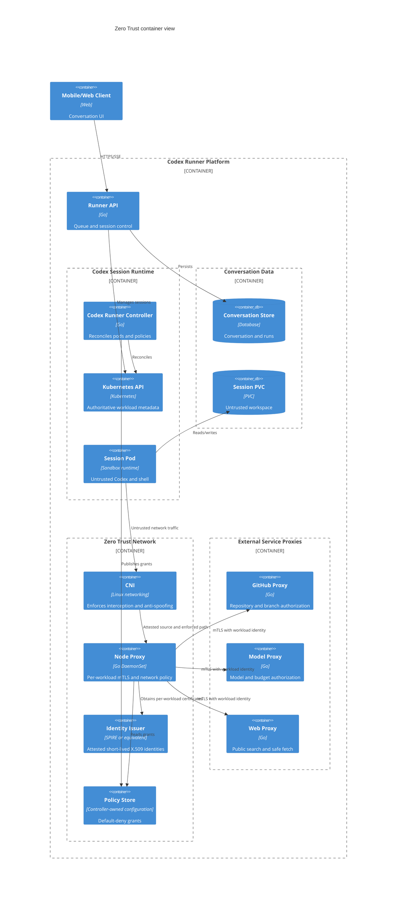
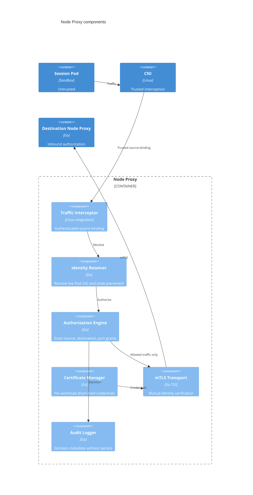

# Zero Trust AI execution — target architecture

Status: proposed implementation, not an enabled production security boundary.

The Session Pod is hostile, including runner-agent, Codex, shell, workspace and all
responses from the pod. No reusable credentials, Kubernetes tokens, host mounts
or shared writable volumes may be exposed to it. Runner API initiates control
connections; results flow back on those connections.

## C4 Level 1

## C4 Level 2

## C4 Level 3 — Node Proxy

## Security invariants

- Identity is a canonical SPIFFE URI, not a caller-supplied header or an IP.
  Session identities include a non-reusable Pod UID. The issuer must attest node
  placement and workload ownership; a node may not request arbitrary identities.
- TLS 1.3, verified chain, exact URI SAN, proof of key possession. The destination
  independently authorizes the source. Private keys stay outside execution pods.
- Explicit deny by default, even during startup, stale policy, or proxy failure.
  CNI must enforce ingress and egress including same-node, host, IPv6, metadata,
  DNS and direct-IP traffic. Kubernetes NetworkPolicy alone is insufficient.
- Policy changes and pod deletion must revoke active connections within a bounded
  interval. No session can write policy or obtain another session identity.
- GitHub grants are per repository, operation and session-owned branch; no merge
  or protected-branch push. GitHub Actions and untrusted PR workflows must not
  expose privileged credentials. Web search/fetch permits data exfiltration via
  URLs and queries; explicit user acceptance of this residual risk is required.
- Model credentials live outside session pods; API-key and ChatGPT login modes
  are distinct and compatibility must be tested.
- Treat the node, CNI, issuer, controller and external proxies as trusted computing
  base; node compromise is outside the session isolation guarantee.

## Activation gates

Do not enable production sessions on this design until the CNI binding,
certificate issuance/rotation, revocation, policy distribution, inbound/outbound
interception, controller integration, sandbox runtime and external proxy
authorization are implemented and adversarial multi-node tests pass.
Existing deployments remain unchanged while this is developed.
